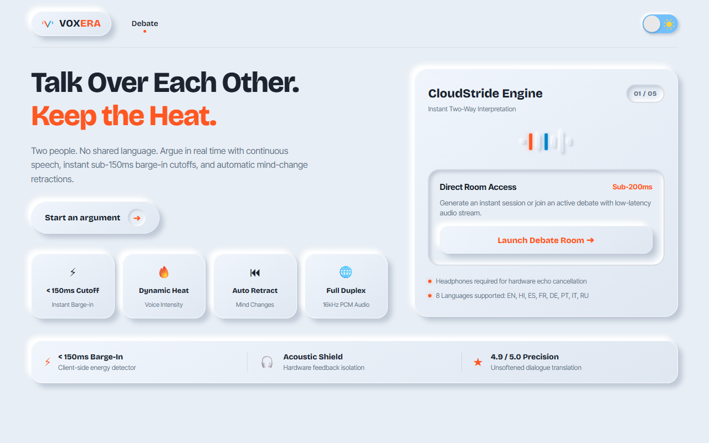
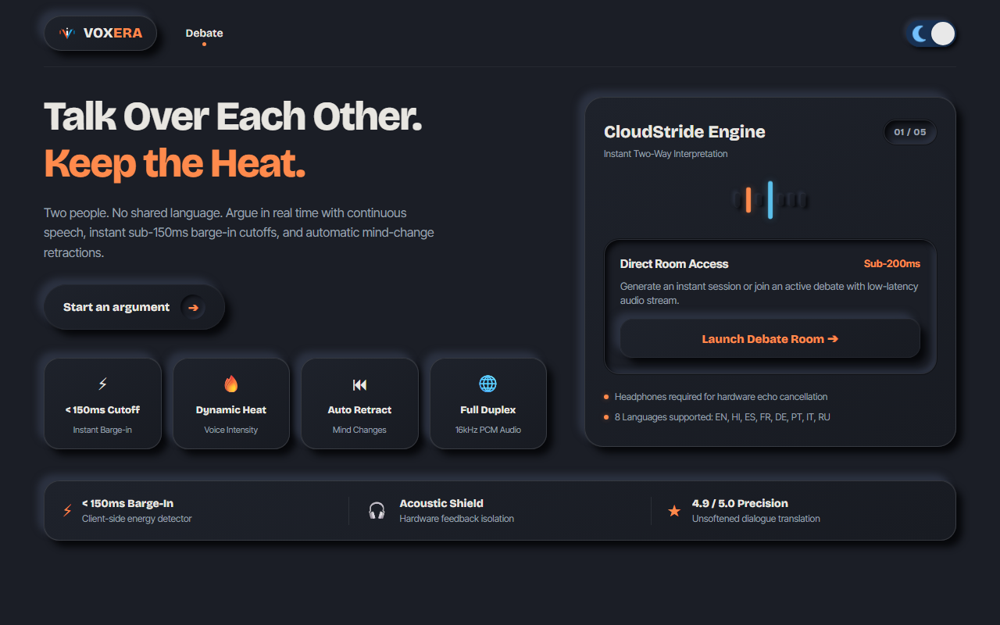
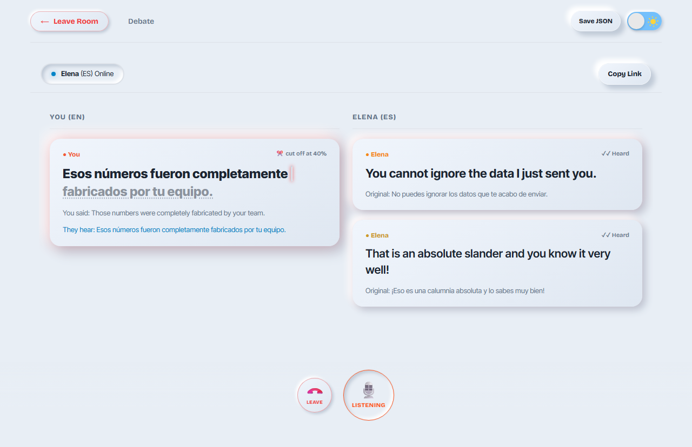
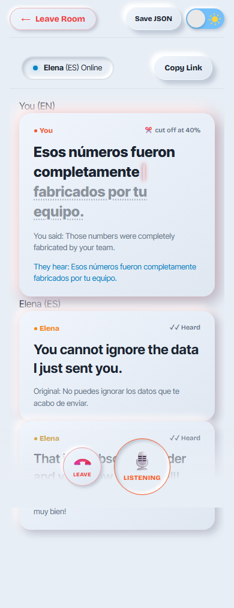

# Voxera ⚡

**Real-time full-duplex speech translation and debate interpreter for natural, continuous cross-language conversation.**

[](LICENSE)
[](https://www.typescriptlang.org/)
[](https://react.dev/)
[](https://nodejs.org/)

**Author:** [Ankit Kumar](https://github.com/arsonic-dev)  
**GitHub:** [@arsonic-dev](https://github.com/arsonic-dev)  
**Repository:** [https://github.com/arsonic-dev/Voxera](https://github.com/arsonic-dev/Voxera)

---

## Overview

Traditional translation tools require rigid turn-taking, suppress emotion, and fail during spontaneous conversation when speakers interrupt or talk over one another.

**Voxera** breaks this paradigm. Designed specifically for high-intensity debates and conversations between speakers with no common language, it enables:
- **Instant Full-Duplex Dialogue:** Both participants can speak simultaneously.
- **Sub-150ms Client-Side Barge-In:** Starting to speak immediately halts incoming audio on your device, preventing overlapping speech loops.
- **Accurate Interruption Tracking:** Both screens render a precise red cutoff marker showing the exact word heard before an interruption occurred.
- **Real-Time Mind-Change Retraction:** Self-corrections ("no wait", "I mean", "forget that") automatically retract prior pending audio and strike through previous statements.
- **Acoustic & Dynamic Heat Scaling:** Captures pace, volume, and emotional intensity without flattening or softening expressions.

---

## Studio Neumorphism Interface

| Soft Clay Light Mode | Obsidian Dark Mode |
| :---: | :---: |
|  |  |

| Real-Time Debate Room | Mobile Experience (Responsive 360px+) |
| :---: | :---: |
|  |  |

---

## Pipeline Architecture

```
                                  VOXERA SERVER
                           ┌───────────────────────────────────────────────┐
                           │                                               │
Speaker Mic                │  ┌──────────────┐      ┌───────────────────┐  │
(16kHz PCM mono) ─WS Audio─►│  │  STT Stream  │      │  Segment Commit   │  │
via AudioWorklet           │  │(Deepgram/Fake│─────►│ (>=3 words/punct/ │  │
                           │  └──────────────┘      │   speech_final)   │  │
                           │                        └─────────┬─────────┘  │
                           │                                  │            │
                           │                                  ▼            │
                           │                        ┌───────────────────┐  │
                           │                        │  LLM Interpreter  │  │
                           │                        │  (Claude / OpenR) │  │
                           │                        └─────────┬─────────┘  │
                           │                                  │            │
                           │                                  ▼            │
                           │                        ┌───────────────────┐  │
                           │                        │   TTS Streaming   │  │
                           │                        │(ElevenLabs Flash) │  │
                           │                        └─────────┬─────────┘  │
                           │                                  │            │
                           └──────────────────────────────────┼────────────┘
                                                              │
                                                    WebSocket Audio Chunks
                                                              │
                                                              ▼
                                                  Listener Web AudioContext
                                                  (SegmentPlayer scheduled nodes)
                                                              │
                                                     Local Mic Energy Check
                                                              ▼
                                                  BargeInDetector (< 150ms)
                                                  halts playback & syncs server
```

### Sequence Flow

```mermaid
sequenceDiagram
    autonumber
    participant A as Speaker A (Mic)
    participant S as Voxera Server
    participant B as Listener B (Speaker)

    A->>S: 16 kHz PCM frames (100ms)
    S-->>A: Live interim source captions {t: "src"}
    Note over S: Segment Commit (>=3 words or punctuation)
    S->>S: LLM Stream Header: {intensity, emotion, retracts}
    S-->>A: Translated caption {t: "tr"}
    S-->>B: Translated caption {t: "tr"}
    S->>B: Streamed audio chunks {t: "audio"}
    Note over B: Audio playback begins
    B->>B: Listener starts speaking (sustained voice >= 150ms)
    Note over B: Local Barge-In: Audio stops immediately
    B->>S: Barge-in event {t: "barge_in", playedMs, totalMs}
    S->>S: Abort TTS & LLM; compute heardText = words * pct
    S-->>A: Heard event {t: "heard", heardText, pct}
    S-->>B: Heard event {t: "heard", heardText, pct}
    Note over A,B: Red marker rendered; unheard text dimmed
```

---

## Key Features & Mechanics

### 1. Client-Side Barge-In Detection
- Runs locally in `web/src/audio/bargeIn.ts` evaluating mic RMS energy frames with a 150ms sustained voice threshold.
- Threshold dynamically scales during active playback to prevent speaker echo feedback.
- Halts Web Audio playback immediately (< 150ms) without waiting for network round-trips.

### 2. Precise Heard Word Calculation
- Server calculates played fraction `pct = min(1.0, max(0.0, playedMs / totalMs))`.
- Words are sliced accurately across boundaries: `heardText = words.slice(0, round(words.length * pct)).join(' ')`.
- Both interfaces render a crisp 2px red indicator marking the cutoff point, dimming unvoiced remainder text.

### 3. Mind-Change Retractions
- Natural self-correction phrases ("no wait", "I mean", "forget that", "quise decir") are identified in the streaming LLM header.
- If pending in playback queue, target segment is cancelled immediately (`{ t: "cancel", reason: "retracted" }`).
- Already-played items receive a visual strike-through and a **TAKEN BACK** badge.

### 4. Zero-Key Fallback Mode
- Automatic deterministic mock engines (`FakeStt`, `FakeTranslator`, `FakeTts`) activate if vendor API keys are absent, enabling complete local development and testing offline.

---

## Supported Languages

Voxera supports real-time two-way translation across:
- **English** (`en`)
- **Hindi** (`hi`)
- **Spanish** (`es`)
- **French** (`fr`)
- **German** (`de`)
- **Portuguese** (`pt`)
- **Italian** (`it`)
- **Russian** (`ru`)

---

## Getting Started

### Prerequisites
- Node.js 20+
- npm 10+

### Installation

```bash
# Clone the repository
git clone https://github.com/arsonic-dev/Voxera.git
cd Voxera

# Install dependencies
npm install

# Configure environment variables
cp .env.example .env
```

### Environment Configuration

In `.env`:
```env
PORT=8080
DEEPGRAM_API_KEY=your_deepgram_key      # Speech-to-Text
ANTHROPIC_API_KEY=your_anthropic_key    # LLM Translation (or OpenRouter key)
ELEVENLABS_API_KEY=your_elevenlabs_key  # Streaming TTS
```
*(Leave empty to run in deterministic offline fake mode)*

### Running Locally

```bash
# Start both server and frontend dev server
npm run dev

# Or build and launch production bundle
npm run build
npm start
```
Open [http://localhost:5173](http://localhost:5173) (Dev) or [http://localhost:8080](http://localhost:8080) (Prod).

---

## Testing & Verification

```bash
# Run server test suite
npm test

# Run contrast audit (WCAG 2.1 AA)
npx tsx scripts/contrast.ts

# Run simulated debate conversation
npx tsx scripts/sim.ts
```

---

## License

This project is licensed under the MIT License — see the [LICENSE](LICENSE) file for details.

Developed with passion by **Ankit Kumar** ([@arsonic-dev](https://github.com/arsonic-dev)).
