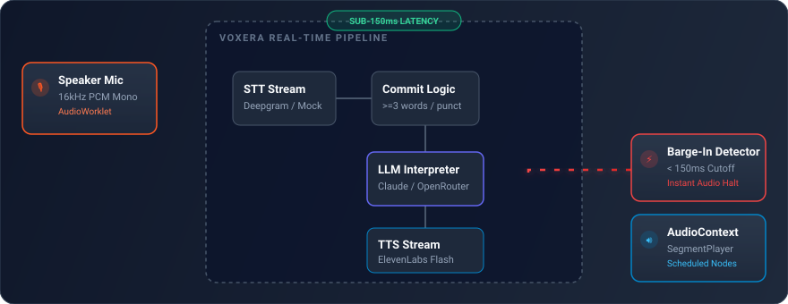
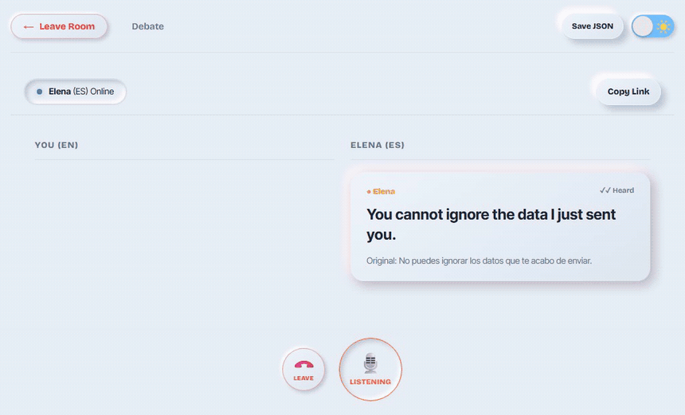

# Voxera

### Real-time speech translation for conversations that don't wait for their turn.

Voxera is a real-time, full-duplex speech translation and debate interpreter built for natural, continuous cross-language conversations. Both participants can speak simultaneously, interrupt one another, and correct themselves without losing the flow of conversation.

<p align="center">
  
</p>

<p align="center">
  <a href="https://github.com/arsonic-dev/Voxera">
    
  </a>
  <a href="LICENSE">
    
  </a>
  
  
</p>

---

## Why Voxera?

Most translation tools are designed around taking turns: one person speaks, the other waits, and the conversation loses its natural rhythm.

Voxera is designed for a completely different experience. It supports spontaneous conversations where speakers interrupt, react, disagree, and change their minds in real time.

> **The goal is to preserve the conversation, not just translate the words.**

---

## Core Capabilities

| Feature | What it does |
| --- | --- |
| **Full-Duplex Dialogue** | Both participants can speak simultaneously without rigid turn-taking or collisions. |
| **Sub-150ms Barge-In** | Local voice energy detection halts incoming audio playback the instant the listener speaks. |
| **Heard Interruption Tracking** | Pinpoints and displays the exact portion of translated speech heard before an interruption. |
| **Mind-Change Retractions** | Automatically detects self-corrections ("no wait...", "I mean...") and marks prior claims as taken back. |
| **Dynamic Heat & Emotion** | Captures pace, volume, and emotional intensity without flattening or softening dialogue. |
| **Zero-Key Offline Fakes** | Deterministic mock engines allow offline development, simulation, and testing with zero API keys. |

---

## Studio Neumorphism Interface

Voxera features a tactile, dual-theme interface designed with subtle directional lighting, crisp raised and inset surfaces, and responsive micro-animations.

| Soft Clay (Light Mode) | Obsidian (Dark Mode) |
| :---: | :---: |
|  |  |

| Real-Time Debate Room Stage | Mobile Responsive (360px+) |
| :---: | :---: |
|  |  |

---

## Architecture & Real-Time Flow

Voxera separates microphone capture, speech recognition, translation, audio synthesis, and playback so that interruption handling remains instantaneous.

<p align="center">
  
</p>

### End-to-End Sequence Flow

```mermaid
sequenceDiagram
    autonumber
    participant A as Speaker A (Mic)
    participant S as Voxera Server
    participant B as Listener B (Speaker)

    A->>S: 16 kHz PCM frames (100ms)
    S-->>A: Live interim source captions {t: "src"}
    Note over S: Segment Commit (>=3 words or punctuation)
    S->>S: LLM Stream Header: {intensity, emotion, retracts}
    S-->>A: Translated caption {t: "tr"}
    S-->>B: Translated caption {t: "tr"}
    S->>B: Streamed audio chunks {t: "audio"}
    Note over B: Audio playback begins
    B->>B: Listener starts speaking (sustained voice >= 150ms)
    Note over B: Local Barge-In: Audio stops immediately
    B->>S: Barge-in event {t: "barge_in", playedMs, totalMs}
    S->>S: Abort TTS & LLM; compute heardText = words * pct
    S-->>A: Heard event {t: "heard", heardText, pct}
    S-->>B: Heard event {t: "heard", heardText, pct}
    Note over A,B: Red marker rendered; unheard text dimmed
```

---

## Technical Highlights

### 1. Client-Side Barge-In & Heard Tracking

Implemented in `web/src/audio/bargeIn.ts`.

<p align="center">
  
</p>

- **Instant Audio Cutoff (< 150ms):** Evaluates microphone RMS energy locally on the listener's device. When sustained voice energy is detected, it stops Web Audio playback immediately without waiting for a server round-trip.
- **Feedback Isolation:** Automatically elevates energy threshold by 50% during active playback to prevent speaker bleed false-triggers.
- **Exact Heard Boundary:** The server calculates the exact played fraction:
  ```ts
  const pct = Math.min(1.0, Math.max(0.0, playedMs / totalMs));
  const words = fullText.split(' ');
  const heardText = words.slice(0, Math.round(words.length * pct)).join(' ');
  ```
  Both screens render a red laser groove marker at the exact cutoff point with unheard remainder text dimmed to 40% opacity.

### 2. Mind-Change Retractions

Conversations naturally contain corrections and course changes:
- *"No wait, forget that number..."*
- *"I mean, look at section 4 instead..."*
- *"Strike that..."*

When a correction is detected:
1. If the target audio is still queued, the server sends `{ t: "cancel", reason: "retracted" }` and the listener's player drops it before playback starts.
2. If already voiced, the previous statement transitions into a strikethrough with a red **TAKEN BACK** badge, and the corrected thought streams in smoothly.

### 3. Deterministic Zero-Key Mock Engine

When third-party API keys are not supplied, Voxera automatically falls back to internal mock engines:
- `FakeStt`: Generates realistic interim and committed speech streams with timing endpoints.
- `FakeTranslator`: Deterministically produces unsoftened translations and structured JSON metadata.
- `FakeTts`: Streams clean 16kHz PCM audio buffers with matching word cadence.

Enables instant local setup, automated unit testing, and Playwright verification without requiring external API credentials.

---

## Supported Languages

Voxera supports bidirectional full-duplex translation across 8 languages:

| Language | Code | Native Name |
| --- | :---: | --- |
| **English** | `en` | English |
| **Hindi** | `hi` | हिन्दी |
| **Spanish** | `es` | Español |
| **French** | `fr` | Français |
| **German** | `de` | Deutsch |
| **Portuguese** | `pt` | Português |
| **Italian** | `it` | Italiano |
| **Russian** | `ru` | Русский |

---

## Technology Stack

| Layer | Component | Technology |
| --- | --- | --- |
| **Frontend** | Framework | React 18.3, Vite 6, TypeScript 5.7 |
| **Audio** | Capture & Playback | Web Audio API, AudioWorklet (16kHz PCM mono) |
| **Styling** | Visual System | Vanilla CSS (Dark Neumorphism & Soft Clay) |
| **Backend** | WebSocket Server | Node.js 22, `ws`, In-Memory Session Manager |
| **Speech-to-Text** | STT Provider | Deepgram Nova-3 / Nova-2 (or `FakeStt`) |
| **Translation** | LLM Engine | Anthropic Claude / OpenRouter (or `FakeTranslator`) |
| **Text-to-Speech** | Streaming Audio | ElevenLabs Flash v2.5 (or `FakeTts`) |

---

## Getting Started

### Prerequisites

- **Node.js** 20 or newer
- **npm** 10 or newer

```bash
node --version
npm --version
```

### Installation

```bash
# Clone repository
git clone https://github.com/arsonic-dev/Voxera.git
cd Voxera

# Install dependencies across all workspaces
npm install

# Copy environment configuration
cp .env.example .env
```

### Environment Configuration

Configure credentials in `.env`:

```env
PORT=8080

# Speech-to-Text
DEEPGRAM_API_KEY=your_deepgram_key

# LLM Translation
ANTHROPIC_API_KEY=your_anthropic_key
# Or use OpenRouter:
OPENROUTER_API_KEY=your_openrouter_key
OPENROUTER_MODEL=anthropic/claude-3.5-haiku

# Streaming Text-to-Speech
ELEVENLABS_API_KEY=your_elevenlabs_key
```

*(Leave API keys empty to run automatically in offline deterministic mock mode)*

### Running Locally

```bash
# Start both server and web frontend dev servers
npm run dev

# Or build and launch the production release
npm run build
npm start
```

- **Frontend (Vite):** `http://localhost:5173`
- **Full-Stack Server:** `http://localhost:8080`

---

## Testing & Verification

```bash
# Run backend test suite (rooms, STT, translation, barge-in, retraction, hardening)
npm test

# Run WCAG 2.1 AA contrast ratio audit
npx tsx scripts/contrast.ts

# Run simulated debate conversation (all 6 retraction cases)
npx tsx scripts/sim.ts

# Capture Playwright automated screenshot suite
npx tsx scripts/screenshot.ts
```

---

## License

Voxera is licensed under the MIT License — see the [LICENSE](LICENSE) file for details.

## Author

**Ankit Kumar**  
- **GitHub:** [@arsonic-dev](https://github.com/arsonic-dev)  
- **Repository:** [https://github.com/arsonic-dev/Voxera](https://github.com/arsonic-dev/Voxera)
